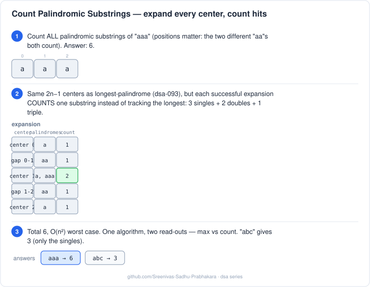

# Palindromic Substrings

> NeetCode 150 · 1-D DP · Blind 75 — expand around all 2n−1 centers, counting each successful widening: every palindrome is counted exactly once, at its own center. Go, stdlib only, tested.

## Problem

Count the palindromic substrings of a string, occurrences included — "aaa" holds six (three a's, two aa's, one aaa).

## Approach

The longest-palindromic-substring machinery (dsa-093) with the maximizer replaced by a counter: from each of the 2n−1 centers (characters and gaps), expand while ends match, and count *every* step — each widening is one distinct palindrome, and every palindrome has exactly one center, so nothing is missed or double-counted. Filed under DP (the O(n²)-table formulation exists), but center expansion does the same work with O(1) space and less code. The brute-force cross-check in the tests makes the counting claim verifiable rather than asserted.

**Complexity:** O(n²) time, O(1) space.

## Visual walkthrough

Read the picture top to bottom — each numbered frame is one moment of the algorithm
running on this repo's test example.

## Run

    go test ./...   # verify
    go run .        # demo

---

Part of a 275-repo DSA series in Go — Striver's SDE Sheet (dsa-001–191) plus the NeetCode 150 / Blind 75 additions (dsa-192–275), stdlib only, every solution tested. Browse: [`dsa-*` repos](https://github.com/Sreenivas-Sadhu-Prabhakara?tab=repositories&q=dsa-&type=source).
